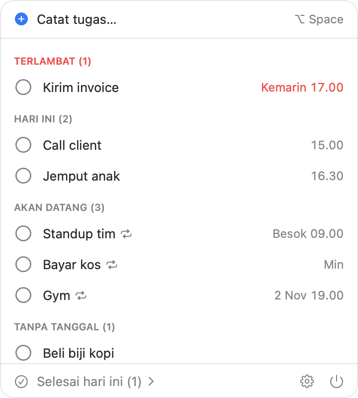

<p align="center">
  
</p>

<h1 align="center">Hachi</h1>

<p align="center">
  <strong>Catat tugas dalam hitungan detik, langsung dari menu bar Mac.</strong><br>
  Tekan <kbd>⌥ Space</kbd>, ketik seperti kamu bicara, lalu diingatkan tepat waktu.
</p>

<p align="center">
  <a href="https://github.com/Linggaept/hachi/releases/latest"></a>
  
  <a href="LICENSE"></a>
</p>

<p align="center"><a href="README.md">English</a> · <strong>Bahasa Indonesia</strong></p>

Catat tugas pakai bahasa sehari-hari dari aplikasi mana pun, boleh diketik atau diucapkan, dan Hachi mengubahnya jadi tugas lengkap dengan tanggal, jam, dan pengingat. Tanpa AI, tanpa akun, semua data tersimpan di Mac ini.

<p align="center">
  
</p>

Namanya diambil dari Hachiko, anjing yang setiap hari menunggu tepat pada jamnya.

Hachi ringan, jadi aman dibiarkan menyala seharian. Saat diam, Hachi hanya memakai sekitar 40 MB memori dan hampir tidak memakai CPU, karena pengingat diserahkan ke macOS untuk dikirim, bukan ditunggu oleh Hachi. Jadi tidak mengganggu app berat seperti browser, aplikasi desain, atau IDE. Ukuran app-nya 3 MB. *(Diukur di Mac M4 dengan macOS 27.)*

Hachi mengerti kalimat **bahasa Indonesia dan Inggris** tanpa perlu memilih bahasa dulu: tiap kalimat dibaca dengan keduanya, lalu dipakai yang paling banyak mengenali bagian waktunya.

## Pasang

Butuh macOS 26 atau lebih baru, di Mac Apple silicon.

1. Unduh `Hachi-<versi>.zip` dari [halaman Releases](https://github.com/Linggaept/hachi/releases/latest), buka zip-nya, lalu pindahkan **Hachi** ke folder Applications.
2. Buka Hachi. Karena belum dinotarisasi Apple, macOS akan menolak saat pertama dibuka. Klik **Selesai**, lalu buka **Pengaturan Sistem → Privasi & Keamanan**, gulir ke bawah, dan klik **Buka Saja** di samping pesan tentang Hachi.

   Cara lain lewat Terminal: `xattr -dr com.apple.quarantine /Applications/Hachi.app`

Hachi harus berada di folder Applications supaya bisa menyala otomatis saat login.

Tampilan Hachi mengikuti bahasa Mac (Inggris atau Indonesia). Kalau ingin bahasa lain khusus untuk Hachi, pilih di **Pengaturan → Bahasa** di Hachi, lalu buka ulang Hachi.

## Pertama kali

1. Buka **Hachi** dari folder Applications. Ikon kepala Shiba muncul di menu bar.
2. Klik **Allow / Izinkan** saat macOS meminta izin notifikasi. Tanpa izin ini, pengingat tidak akan muncul.
3. Saat pertama memakai suara, izinkan **Mikrofon**. Model suara diunduh sekali (butuh internet sebentar). Setelah itu suara jalan offline.
4. Aplikasi otomatis menyala tiap login. Bisa dimatikan di Pengaturan.

## Mencatat tugas

| Cara | Langkah |
|---|---|
| Ketik | Tekan **⌥ Space** dari aplikasi mana pun, ketik, lalu **↩**. |
| Suara | **Tahan ⌥ Space**, bicara, lalu lepas. Periksa hasilnya, lalu **↩**. Bisa juga klik ikon 🎤 di kotak catat. |
| Atur manual | Di kotak catat, tekan **⌘↩** (atau klik pratinjau) untuk membuka form tanggal, jam, pengingat, dan pengulangan. |
| Batal | **esc** atau klik di luar kotak. |

Sambil mengetik, di bawah kotak tampil pratinjau: judul, tanggal/jam, pengingat, pengulangan. Kalau pratinjaunya salah baca, tekan ⌘↩ lalu betulkan di form.

### Contoh kalimat

| Kalimat | Hasil |
|---|---|
| `besok jam 3 sore call client ingetin 30 menit sebelumnya` | Besok 15.00, diingatkan 14.30 |
| `nanti malam telpon ibu` | Hari ini 20.00 |
| `30 menit lagi angkat jemuran` | 30 menit dari sekarang |
| `lusa jam sembilan pagi bayar internet` | Lusa 09.00 |
| `jam setengah lima jemput adik` | 16.30 |
| `jumat depan deadline proposal` | Jumat minggu depan, seharian |
| `tgl 25 bayar listrik` | Tanggal 25, seharian |
| `tiap senin jam 9 cek backup` | Tiap Senin 09.00 |
| `tiap hari kerja jam 8 pagi absen` | Senin–Jumat 08.00 |
| `tiap tanggal 1 bayar kos` | Tiap tanggal 1 |
| `beli kopi` | Tanpa tanggal |

Aturan singkat:
- `jam 1`–`jam 6` tanpa pagi/sore dianggap siang/sore. `jam 7`–`jam 11` dianggap pagi; kalau jam itu sudah lewat hari ini, dipakai malamnya.
- `pagi` 08.00, `siang` 12.00, `sore` 16.00, `malam` 20.00 (bisa diubah di Pengaturan).
- Tugas **seharian** (tanpa jam) tidak berbunyi sendiri, cukup masuk ringkasan pagi. Kalau tetap mau diingatkan, tulis `ingetin` atau pilih di form.

Kalimat bahasa Inggris juga dimengerti, misalnya `tomorrow 3pm call client remind me 30 minutes before`, `every monday and thursday 9am gym`, atau `next friday deadline proposal`. Contoh lengkapnya ada di [README bahasa Inggris](README.md#example-sentences).

Input suara mendengarkan dalam bahasa tampilan Hachi. Kalau ingin bicara dalam bahasa lain, ganti di **Pengaturan → Bahasa suara**.

## Panel menu bar

Klik ikon Shiba untuk melihat panel. Angka di sebelah ikon = jumlah tugas terlambat.

Panel juga bisa dibuka dengan mengetuk <kbd>⌥</kbd> dua kali. Nyalakan dulu di Pengaturan; macOS akan meminta izin Aksesibilitas karena Hachi perlu mengenali tombol Option saat kamu berada di app lain.

<p align="center">
  <picture>
    <source media="(prefers-color-scheme: dark)" srcset="docs/panel-id-dark.png">
    
  </picture>
</p>

- Tugas dikelompokkan jadi **Terlambat · Hari ini · Akan datang · Tanpa tanggal**.
- Klik ○ untuk menandai selesai. Tugasnya tetap di tempat 3 detik (tercoret); salah klik? Klik lagi untuk membatalkan. Klik judul untuk mengubah tugas.
- Klik kanan sebuah tugas untuk Pindah ke besok, Tandai selesai, atau Hapus.
- **Selesai hari ini (n) ›** di bawah membuka daftar tugas yang selesai 30 hari terakhir. Klik ✓ untuk membatalkan kapan saja.
- Tugas berulang (ikon 🔁): setelah ditandai selesai, jadwal berikutnya langsung dibuat.

## Pengingat

Notifikasi muncul pada waktunya, walau panel tertutup atau Mac baru bangun dari tidur. Tombolnya (arahkan kursor ke notifikasi, klik **Options**):
**Selesai · Tunda 10 menit · Tunda 1 jam · Besok**.

**Ringkasan pagi** dikirim sekali sehari, saat Mac pertama dipakai setelah 05.00. Isinya jumlah tugas hari ini dan yang terlambat.

**Tugas tanpa tanggal** yang 14 hari tidak disentuh akan ditanyakan lagi: *Masih / Sudah selesai / Hapus*.

## Pengaturan

Ikon ⚙︎ di panel. Isinya: nyala saat login, pilihan shortcut, bahasa, jam ringkasan pagi, jam bagian hari, status izin, dan **Ekspor/Impor** cadangan JSON.

Data tersimpan di `~/Library/Application Support/Hachi/todo.sqlite`.

## Untuk developer

Tidak butuh Xcode; cukup Command Line Tools.

```sh
swift test               # jalankan test
./scripts/install.sh     # build, pasang ke /Applications, jalankan ulang
./scripts/build-app.sh   # hanya merakit build/Hachi.app
./scripts/release.sh     # membuat build/Hachi-<versi>.zip untuk Releases
```

Setelah build ulang, macOS kadang meminta izin mikrofon/notifikasi lagi karena tanda tangan aplikasinya ad-hoc.

Parser ada di target `TodoParser` dan bisa dites tanpa membuka app. Pola kalimat baru selalu disertai test di `Tests/TodoParserTests`.

Teks tampilan ditulis dalam bahasa Inggris di kode dan diterjemahkan di `Resources/<bahasa>.lproj/Localizable.strings`. Setelah mengubah teks, jalankan `./scripts/check-translations.py` untuk menemukan terjemahan yang kurang atau sudah tidak dipakai.

## Kalau ada masalah

| Masalah | Coba |
|---|---|
| Pengingat tidak muncul | Pengaturan Sistem → Notifikasi → Hachi → izinkan. Matikan Fokus/Jangan Ganggu. |
| ⌥ Space tidak bereaksi | Mungkin bentrok dengan aplikasi lain; ganti shortcut di Pengaturan. |
| Suara gagal | Pengaturan Sistem → Privasi & Keamanan → Mikrofon → nyalakan Hachi. Pertama kali butuh internet untuk mengunduh model. |
| Ikon hilang dari menu bar | Buka lagi Hachi dari Applications. Kalau menu bar penuh, ikon bisa tertutup notch. |

## Privasi

Hachi tidak punya server, akun, maupun analitik. Tugas dan pengaturan hanya tersimpan di Mac ini. Suara dikenali di perangkat. Kalau pengenal di perangkat gagal, Hachi memakai pengenal suara server Apple, sehingga rekaman suara itu dikirim ke Apple.

## Lisensi

[MIT](LICENSE)
