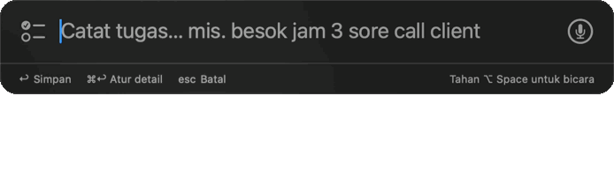
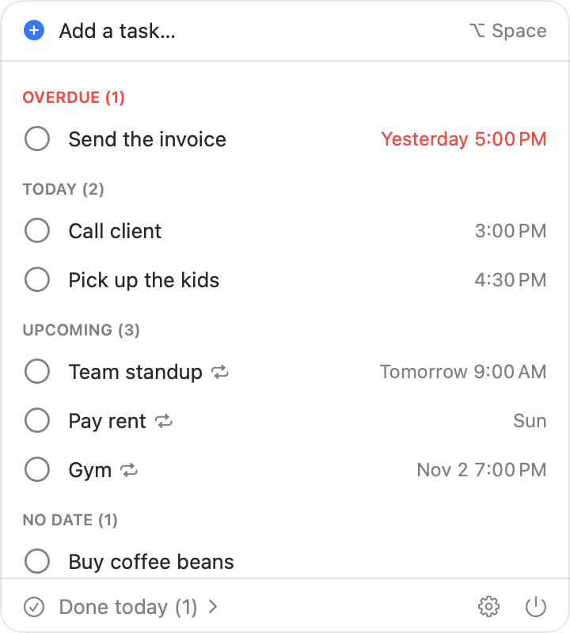

<p align="center">
  
</p>

<h1 align="center">Hachi</h1>

<p align="center">
  <strong>Capture a to-do in seconds, right from your Mac's menu bar.</strong><br>
  Press <kbd>⌥ Space</kbd>, type it the way you'd say it, and get reminded on time.
</p>

<p align="center">
  <a href="https://github.com/Linggaept/hachi/releases/latest"></a>
  
  <a href="LICENSE"></a>
</p>

<p align="center"><strong>English</strong> · <a href="README.id.md">Bahasa Indonesia</a></p>

Type or say what you need to do in everyday language, from any app, and Hachi turns it into a task with the right date, time, and reminder. No AI, no account, no server. Everything stays on your Mac.

<p align="center">
  
  <br>
  <sub>Typed in Indonesian here. English sentences work the same way.</sub>
</p>

Named after Hachiko, the dog who waited at the station at the same time every day.

Hachi understands sentences in **English and Indonesian**. You don't pick a language first: each sentence is read in both, and the one that recognizes more of it wins. The app itself is available in both languages too.

## Why Hachi

- **Fast to capture.** One shortcut opens a small Spotlight-style box. Type, press <kbd>↩</kbd>, done. Hold the shortcut to dictate instead.
- **Understands plain sentences.** `tomorrow 3pm call client remind me 30 minutes before` becomes *Call client · tomorrow 3:00 PM · reminder 2:30 PM*. So does the Indonesian `besok jam 3 sore call client ingetin 30 menit sebelumnya`. A live preview shows what was understood before you save.
- **Reminders that arrive on time,** even when the panel is closed or the Mac just woke up. Act on them right from the notification: Done, Snooze 10 min, Snooze 1 hour, Tomorrow.
- **Repeating tasks** like "every Monday" or "every 1st of the month" reschedule themselves when you complete them.
- **Morning summary** once a day, and a gentle check on undated tasks you haven't touched for 14 days.
- **Light enough to leave running all day.** While idle, Hachi uses about 40 MB of memory and practically no CPU, because reminders are handed to macOS to deliver instead of Hachi watching the clock. It stays out of the way of heavy apps like browsers, design tools, or IDEs. The whole app is 3 MB. *(Measured on an M4 Mac with macOS 27.)*
- **Native and dependency-free.** Swift and SwiftUI, with macOS's built-in SQLite and speech recognition.

## Install

Requires macOS 26 or later on Apple silicon.

1. Download `Hachi-<version>.zip` from the [Releases page](https://github.com/Linggaept/hachi/releases/latest), unzip it, and move **Hachi** to your Applications folder.
2. Open Hachi. Because it isn't notarized by Apple, macOS blocks it the first time. Click **Done**, go to **System Settings → Privacy & Security**, scroll down, and click **Open Anyway** next to the message about Hachi.

   Or in Terminal: `xattr -dr com.apple.quarantine /Applications/Hachi.app`

3. Allow notifications when asked. The first time you use voice, allow the microphone; the speech model downloads once, then works offline.

Hachi starts automatically at login. You can turn this off in Settings. Hachi has to be in the Applications folder for this to work.

The interface follows your Mac's language (English or Indonesian). To use a different language for Hachi only, pick it under **Settings → Language** in Hachi, then restart Hachi.

## Using Hachi

| Action | How |
|---|---|
| Add a task | <kbd>⌥ Space</kbd>, type, <kbd>↩</kbd> |
| Dictate | Hold <kbd>⌥ Space</kbd>, speak, release, check, <kbd>↩</kbd> |
| Set details by hand | <kbd>⌘ ↩</kbd> in the capture box opens a form for date, time, reminder, and repeat |
| Cancel | <kbd>esc</kbd> |
| See your list | Click the Shiba icon in the menu bar. The number next to it is how many tasks are overdue. |
| Open the list from the keyboard | Double-tap <kbd>⌥</kbd>. Turn it on in Settings first; macOS asks for Accessibility permission because Hachi has to notice the Option key in other apps. |

The shortcut can be changed in Settings.

<p align="center">
  <picture>
    <source media="(prefers-color-scheme: dark)" srcset="docs/panel-dark.png">
    
  </picture>
</p>

### Example sentences

| You write | Hachi understands |
|---|---|
| `tomorrow 3pm call client remind me 30 minutes before` | Tomorrow 3:00 PM, reminder at 2:30 PM |
| `call mom tonight` | Today 8:00 PM |
| `in 30 minutes take out laundry` | 30 minutes from now |
| `next friday deadline proposal` | Friday next week, all day |
| `half past 4 pick up kids` | 4:30 PM |
| `oct 25 pay electricity` | October 25, all day |
| `every monday and thursday 9am gym` | Every Monday and Thursday 9:00 AM |
| `every weekday at 8 check in` | Monday to Friday 8:00 AM |
| `every month on the 1st pay rent` | The 1st of every month |
| `buy coffee` | No date |

In Indonesian:

| You write | Hachi understands |
|---|---|
| `besok jam 3 sore call client ingetin 30 menit sebelumnya` | Tomorrow 15.00, reminder at 14.30 |
| `nanti malam telpon ibu` | Today 20.00 |
| `30 menit lagi angkat jemuran` | 30 minutes from now |
| `lusa jam sembilan pagi bayar internet` | The day after tomorrow, 09.00 |
| `jam setengah lima jemput adik` | 16.30 |
| `jumat depan deadline proposal` | Friday next week, all day |
| `tgl 25 bayar listrik` | The 25th, all day |
| `tiap senin jam 9 cek backup` | Every Monday 09.00 |
| `tiap hari kerja jam 8 pagi absen` | Monday to Friday 08.00 |
| `beli kopi` | No date |

How ambiguous times are read:

- A time without am/pm (`at 3`, `jam 3`) from 1 to 6 means afternoon. From 7 to 11 it means morning, unless that time has already passed today, then it means evening.
- Morning (`pagi`) 8:00, midday (`siang`) 12:00, afternoon (`sore`) 4:00 PM, evening (`malam`) 8:00 PM. These can be changed in Settings. Words like `morning` only count when attached to a day (`tomorrow morning`), so `morning run` stays a title.
- `next friday` / `jumat depan` is Friday of next week (weeks start on Monday). `friday` / `jumat` alone is the nearest Friday.
- Numeric dates like `10/25` follow your Mac's region (month first in the US).
- All-day tasks don't ring on their own; they show up in the morning summary. Add `remind me` or `ingetin` if you want a reminder anyway.

Voice input listens in the app's language by default. To speak in another language, change **Settings → Voice language**.

## Privacy

Hachi has no server, no account, and no analytics. Tasks and settings are stored only on your Mac, in `~/Library/Application Support/Hachi/`. Speech is recognized on-device. If on-device recognition fails, Hachi falls back to Apple's server-based speech recognition, which sends that recording to Apple.

## Build from source

No Xcode needed, only the Command Line Tools.

```sh
swift test               # run the tests
./scripts/install.sh     # build, install to /Applications, and relaunch
./scripts/build-app.sh   # only assemble build/Hachi.app
./scripts/release.sh     # build and zip build/Hachi-<version>.zip
```

The app is signed ad hoc, so macOS may ask for notification and microphone permission again after a rebuild.

Interface text is written in English in the code and translated in `Resources/<language>.lproj/Localizable.strings`. After changing any text, run `./scripts/check-translations.py` to find strings that are missing or no longer used.

## Contributing

Issues and pull requests are welcome. The sentence parser lives in the `TodoParser` target and can be tested without running the app. Every new sentence pattern should come with tests in `Tests/TodoParserTests`.

## License

[MIT](LICENSE)
